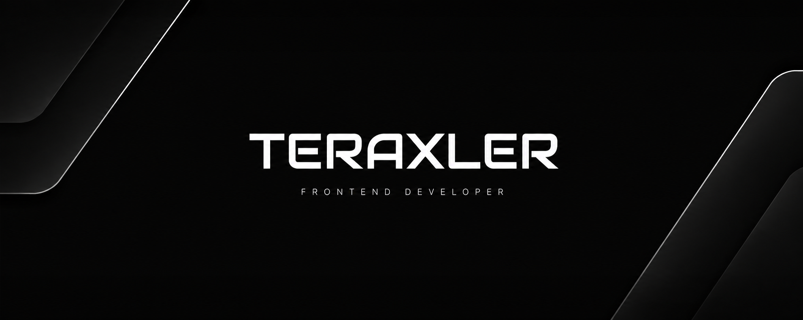
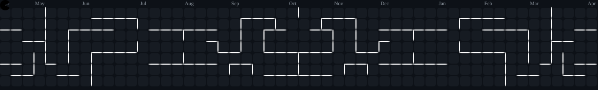

# Hi, I'm Mahdi Akbari (Teraxler)

I build web applications with a focus on clean code, maintainable architecture, and software engineering best practices.

## Tech Stack

### Frontend:

### State Managment:

### Tools:

## Featured Projects

### Coffee Shop Admin Dashboard

A full-stack admin dashboard for managing coffee shop operations, built with Next.js, React, and Express. Focused on maintainable architecture and reusable components.

**Key Features**

- Feature-based code organization

- CRUD operations and data visualization

- Form validation, error handling

- Authentication and protected routes

- REST API integration

 

**Tech Stack:** Next.js · React · Tailwind CSS · Express · SQL Server · Zod

[View Repository](https://github.com/Teraxler/Admin-Panel) • [Live Demo](https://teraxler-admin-panel.vercel.app/)

---

### Advanced Todo-List

A task management project focused on implementing application functionality and managing user interactions.

**Key Features**

- Implemented CRUD operations for todos

- Supported image uploads for todo items

- Added user authentication and protected routes

 

**Tech Stack:** Tailwind CSS · JavaScript · CSS · HTML

[View Repository](https://github.com/Teraxler/Todo-list-website) • [Live Demo](https://teraxler.github.io/Todo-list-website/public/pages/login.html)

## Connect with me

  
  
  

 

